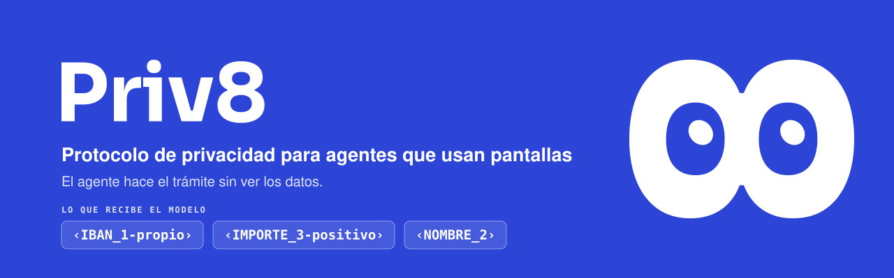
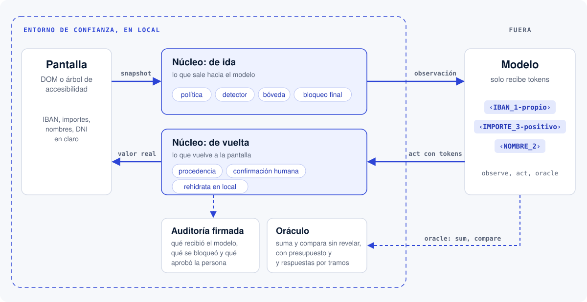

<picture>
  <source media="(prefers-color-scheme: dark)" srcset="brand/banner/readme-oscuro.svg">
  <source media="(prefers-color-scheme: light)" srcset="brand/banner/readme.svg">
  
</picture>

# Priv8

**Priv8 CUA** es un protocolo de privacidad para *computer-use agents*: agentes de IA que usan pantallas como una persona. Cada dato sensible de la pantalla (un IBAN, un importe, un nombre) se cambia por un token tipado, como `‹IBAN_1-propio›` o `‹IMPORTE_3-positivo›`, antes de llegar al modelo. El valor real solo vuelve en local, en el momento de escribirlo en la pantalla. El agente hace el trámite completo y los datos no salen del entorno de confianza. Lo que pide una confirmación humana queda retenido hasta que la persona lo aprueba, y todo queda en un registro firmado.

> Visa y Google resolvieron cómo paga un agente. Priv8 resuelve qué ve mientras trabaja.

El agente se llama **8**. Proyecto para Hackfinance, Madrid Engineering Week 2026. Todos los datos, bancos y empresas de la demo son inventados.

**[Web](https://priv8.es)** | **[Demo en el navegador](https://demo.priv8.es)** | **[Priv8 como servidor MCP](https://mcp.priv8.es)** | **Presentación** (pendiente) | **[Especificación](docs/SPEC.md)**

## Cómo funciona

<picture>
  <source media="(prefers-color-scheme: dark)" srcset="docs/img/como-funciona-oscuro.svg">
  <source media="(prefers-color-scheme: light)" srcset="docs/img/como-funciona.svg">
  
</picture>

1. **Lectura.** El adaptador lee la pantalla como estructura, no como píxeles: el DOM con Playwright en la web y el árbol de accesibilidad en Android.
2. **Ida.** El núcleo aplica la política del sitio y el detector (IBAN con mod-97, DNI y NIE con su letra, tarjetas con Luhn, nombres y la bóveda local). Clasifica cada dato en tres clases:
   - **Rojo, nunca sale:** contraseñas, PIN, OTP y tarjeta completa.
   - **Ámbar, se tokeniza:** IBAN, DNI, nombres, importes y movimientos.
   - **Verde, libre:** la interfaz.

   Un bloqueo final para la petición si algún patrón sensible se escapa sin tokenizar.
3. **Modelo.** Solo tiene tres herramientas: `observe`, `act` y `oracle`. El oráculo suma y compara sin revelar las cifras, con un presupuesto de preguntas y respuestas por tramos.
4. **Vuelta.** El modelo escribe tokens. El núcleo comprueba la procedencia (un IBAN que llega por correo no puede convertirse en la cuenta de pago), pide confirmación humana para registrar, transferir o enviar, y el ejecutor pone el valor real en la pantalla.
5. **Auditoría.** Cada paso queda en un registro firmado con ed25519: qué recibió el modelo, qué se bloqueó y qué aprobó la persona.

La respuesta de 8 también llega con tokens. Un renderizador local pone los valores antes de enseñarla. En la voz, ElevenLabs lee las frases sin datos y la voz local del dispositivo lee las cifras y los nombres.

## Dos verticales sobre el mismo núcleo

**B2B: Priv8 para empresas.** Es un arnés para automatizar con IA procesos que hoy no se automatizan por miedo a exponer datos. En la demo llega un correo con la factura de un proveedor. 8 la registra en un ERP antiguo (Alba Core, simulado) sin ver los datos y contesta el correo. El mismo correo trae un cambio de IBAN, y 8 lo bloquea por procedencia. Después llama al proveedor al teléfono de su ficha. Todo queda en el registro firmado y en la consola de auditoría.

**B2C: 8 en tu móvil.** Es una app Android para el emulador que maneja las apps de banca simuladas (Banca Alcor, Brezo Banco y Nimbo Bróker) por accesibilidad y habla con voz. Responde a "¿cuánto tengo entre mis bancos?" y prepara una transferencia con confirmación por voz. Mientras la persona pone su huella, su clave o el código, 8 mira a otro lado. No asesora inversiones ni firma por nadie.

## Probarlo

Cuatro formas de ejecutar Priv8 desde el código, de menos a más montaje:

| Modo | Comando principal | Necesita | `ANTHROPIC_API_KEY` | Tiempo aproximado |
|---|---|---|---|---|
| 1. Las dos escenas sin claves | `make demo` | uv | No | 1 min la primera vez (`uv sync`); después, segundos |
| 2. B2B en vivo: ERP, correo y consola | `make demo-b2b` | uv, Node 20+, pnpm | Sí | 3-5 min la primera vez (`make web-install`); después, 30 s |
| 3. B2C en el emulador | `scripts/movil.sh` y `make agent-android` | Android Studio, AVD Android 14, JDK 17 | Sí (`make agent-android-replay`: no) | 10-15 min la primera vez (compilar e instalar); después, 2 min |
| 4. Priv8 con tu Claude Code | `make mcp-web` | uv, Node 20+, pnpm, Claude Code | No: el modelo lo pone tu Claude Code | 5 min |

Todos parten de una copia del repositorio o del ZIP descargado con "Download ZIP".

### 1. Sin claves, en un minuto

```bash
uv sync      # Python 3.12 y las dependencias exactas de uv.lock
make demo    # las dos escenas con el núcleo real y respuestas del modelo grabadas
```

Sin make: `uv run python -m core.replay` (`b2b` o `b2c` como argumento para una sola escena).

Por cada paso se ve lo que recibe y pide el modelo, siempre con tokens. Al final aparecen la respuesta de 8 renderizada en local y el número de peticiones que llevaban algún valor real (debe ser 0). También salen un resumen de la auditoría y la comprobación del registro firmado `audit/replay.jsonl`.

Lo que hay que mirar:

- **B2B:** `act type e9 ‹IBAN_1-correo›` devuelve `denied: destino` porque el IBAN del correo no entra en el pago. Registrar y Enviar quedan retenidos hasta que la persona confirma.
- **B2C:** `oracle sum` devuelve `‹SUMA_1›` y la cifra solo se ve en local. La transferencia pide confirmación y 8 queda en pausa durante la huella.

### 2. B2B en vivo: ERP, correo y consola

Necesita `ANTHROPIC_API_KEY` en `.env` (ver [Configuración](#configuración)), Node 20 o superior y pnpm.

```bash
uv sync
cp .env.example .env   # y rellena ANTHROPIC_API_KEY
make web-install   # una vez: dependencias de las tres apps web y Chromium
make demo-b2b      # Alba Core :5173, correo :5174, consola :5175 y 8 esperando encargos
```

Abre la consola en http://127.0.0.1:5175 y pídele a 8 «registrar factura». Alba Core abre con la sesión ya iniciada, como el ordenador de una empresa: nadie escribe la clave, ni la persona ni 8. Lo retenido se aprueba en la consola. `Ctrl-C` para el agente y las apps que arrancó el comando.

Si prefieres hacerlo por partes, ejecuta `make web` en una terminal y `make agent-web` en otra. En ese caso Alba Core pide entrar la primera vez con `admin.alba` / `Alba-2026!`. La clave la escribe la persona en la ventana de Chromium.

### 3. B2C en el emulador de Android

Necesita Android Studio, un emulador (AVD) de Android 14 llamado `priv8`, un JDK 17 en `JAVA_HOME` y `ANDROID_HOME` apuntando al SDK (ver [`apps/android-8/README.md`](apps/android-8/README.md)). `make agent-android` necesita además `ANTHROPIC_API_KEY` exportada en la terminal (o `uv run --env-file .env python -m agent.agent --android`).

```bash
uv sync
scripts/movil.sh             # compila la app 8 y los bancos, arranca el AVD, instala y abre los puertos
make agent-android-replay    # respuestas grabadas, sin clave
make agent-android           # con Claude en vivo; necesita ANTHROPIC_API_KEY
```

La persona entra en el banco, confirma y escribe el código en el móvil. 8 nunca lo hace.

### 4. Priv8 con tu Claude Code

Priv8 CUA es un servidor MCP. Claude Code, Claude Desktop o cualquier otro host MCP puede usarlo como su capa de *computer use*, con las mismas tres herramientas y las mismas protecciones que 8. Aquí no hace falta `ANTHROPIC_API_KEY`, porque el host pone su propio modelo. La guía paso a paso está en [mcp.priv8.es](https://mcp.priv8.es).

```bash
uv sync && make web-install   # una vez
make web        # Alba Core, correo y consola (en otra terminal)
make mcp-web    # Priv8 en http://127.0.0.1:8701/mcp, sesión b2b
claude mcp add --transport http priv8 http://127.0.0.1:8701/mcp
```

Después, pídelo en lenguaje normal: «Usa priv8 para registrar en Alba Core la factura que ha llegado por correo». Para el móvil: `scripts/movil.sh --no-build` y `make mcp-android`. No lo lances a la vez que `make agent-web` o `make agent-android`, porque comparten los puertos 8700, 8701 y 8765.

Priv8 protege lo que el agente lee y escribe en la pantalla, pero no el chat del host. Lo que escribes en Claude Code llega al modelo tal cual, así que no pegues ahí un IBAN, un DNI ni un importe. Más detalle, incluido el modo stdio, en [`agent/README.md`](agent/README.md).

### Otras pruebas sin claves

```bash
make llamada-banco                          # 8 llama a la línea simulada de Banca Alcor y cede la llamada
make metrics                                # métricas B2B y B2C con y sin protocolo (metrics/out/)
uv run python -m core.verify audit/replay.jsonl   # comprueba el registro firmado
```

## Requisitos

- [uv](https://docs.astral.sh/uv/). Instala por su cuenta Python 3.12 y las dependencias; no hace falta tener Python.
- `make`. En Windows, cada objetivo del `Makefile` es un comando `uv run ...` que se puede ejecutar directamente.
- Web en vivo: Node 20 o superior y [pnpm](https://pnpm.io).
- Android: Android Studio, un emulador de Android 14 y un JDK 17.
- Claves, solo para el modo en vivo: API de Claude y, si quieres la voz en la nube, ElevenLabs.

## Configuración

Solo hace falta para el modo en vivo:

```bash
cp .env.example .env
```

| Variable | Para qué | Por defecto |
|---|---|---|
| `ANTHROPIC_API_KEY` | Agente en vivo con Claude | - |
| `PRIV8_MODEL` | Modelo del agente; uno más barato para pruebas, p. ej. `claude-sonnet-5-5` | `claude-opus-5-5` |
| `PRIV8_EFFORT` | Esfuerzo de razonamiento (`low` para pruebas) | `high` |
| `PRIV8_TASK_BUDGET_USD` | Límite de gasto por encargo, en dólares | `0.05` |
| `PRIV8_SESSION_BUDGET_USD` | Límite de gasto de la sesión (el proceso del agente) | `0.50` |
| `PRIV8_CORE` | `real` (el núcleo de `core/`) o `fake` (simulado en memoria) | `real` |
| `PRIV8_AUDIT` | Registro firmado; `off` lo deja solo en memoria | `audit/priv8.jsonl` |
| `PRIV8_AUDIT_KEY` | Clave ed25519 del registro; se crea si no existe | `audit/priv8.key` |
| `ELEVENLABS_API_KEY`, `ELEVENLABS_VOICE_ID` | Voz en la nube (ver [`voice/README.md`](voice/README.md)) | - |

Cuando un encargo o la sesión llega a su límite, 8 para y lo dice en el chat de la consola. El tope total se pone en la Console de Anthropic, como límite de gasto del workspace de la clave. `make demo-b2b` lee el `.env` por su cuenta. Para el resto de comandos: `uv run --env-file .env ...`. Las variables de la llamada real, sin probar todavía, están en `.env.example`.

## Tests

```bash
make test
```

Ejecuta las suites de Python (núcleo, agente, voz, adaptadores, métricas y la batería de correos trampa), valida los ejemplos de los contratos y el seed, y corre los tests de la consola, del ERP y de los estados de la app 8. Entre otras cosas comprueba:

- que ningún valor real llega al modelo;
- las 10 variantes del correo que cambia el IBAN;
- que la confirmación caduca;
- que el oráculo no deja reconstruir una cifra;
- que la auditoría detecta alteraciones;
- que el ERP y el correo reales, a través del adaptador web, no sueltan ningún dato del seed. Estos tests arrancan las apps si están instaladas y, si no, se saltan.

La lista de conformidad del protocolo, con el test que prueba cada punto, está en [`docs/SPEC.md`](docs/SPEC.md).

## Estructura

```
core/            Núcleo Priv8 CUA: detector, tokens, bóveda, oráculo, ejecutor, confirmación, auditoría y replay
policies/        Políticas por sitio en YAML: qué es rojo, ámbar o verde en cada pantalla
agent/           Servidor MCP (observe, act, oracle) y bucle del agente con Claude
adapters/        Adaptadores de pantalla: web (Playwright, DOM) y Android (puente WebSocket)
voice/           Voz mixta, llamada al banco, llamada de verificación y dictado local
apps/android-8/  App 8 para Android: servicio de accesibilidad, ojos, voz y confirmaciones
apps/banks-sim/  Banca Alcor, Brezo Banco y Nimbo Bróker: bancos simulados para Android
apps/erp-sim/    Alba Core, el ERP antiguo simulado
apps/inbox-sim/  Bandeja de correo simulada con la factura del proveedor
apps/console/    Consola de auditoría: lo que ve 8, lo retenido y el chat con 8
apps/landing/    Web priv8.es
metrics/         Métricas B2B y B2C con y sin protocolo
data/            Datos inventados de la demo (seed.json) y su validación
scripts/         Emulador, demo B2B en un comando, factura en PDF y vídeos de la consola
docs/            Especificación, contratos, arquitectura, plan, marca, 8 y entregables
brand/           Logos, banner, icono, variables de marca y esquema de expresiones de 8
bases/           Bases y rúbrica oficiales de la hackathon
research_notes/  Investigación de mercado previa a la elección del producto
reports/         Informe que llevó a la decisión de producto
```

`core/`, `agent/`, `voice/`, cada adaptador y cada app tienen su propio README. Los `.html` de `docs/` se abren directamente en el navegador:

| Archivo | Qué es |
|---|---|
| [`docs/SPEC.md`](docs/SPEC.md) | Especificación del protocolo: clases de dato, tokens, piezas, herramientas y conformidad |
| [`docs/contracts/`](docs/contracts/) | Contratos en JSON Schema con ejemplos (`uv run python docs/contracts/validate.py`) |
| `docs/arquitectura.html` | Arquitectura, contratos, flujos, despliegue y reparto. Resumen en [`docs/arquitectura.md`](docs/arquitectura.md) |
| `docs/plan.html` | Estrategia: las dos verticales, demo, métricas y rúbrica |
| `docs/marca.html` | Guía de marca |
| `docs/ojos.html` | 8 en vivo, con sus estados y el código de animación |
| `docs/entregables/` | PDF de una cara, diapositivas y vídeos de la consola con y sin protocolo |
| `docs/archivo/` | Exploraciones sustituidas que se conservan como registro |

## Equipo

| Persona | Parte |
|---|---|
| Ángel Martín ([@aaangelmartin](https://github.com/aaangelmartin)) | Agente, servidor MCP, Android, voz y diseño |
| Álvaro Carpintero ([@alvaarocl](https://github.com/alvaarocl)) | Empresa: ERP, bandeja, adaptador web, consola y telefonía |
| Pablo Rojo ([@rrojjo](https://github.com/rrojjo)) | Núcleo del protocolo y especificación |
| Marco Barroso ([@marcoobarroso](https://github.com/marcoobarroso)) | App 8, renderizador local, bancos y dictado |

## Licencia

Apache 2.0. Ver [`LICENSE`](LICENSE) y [`NOTICE`](NOTICE).

by laaabs
