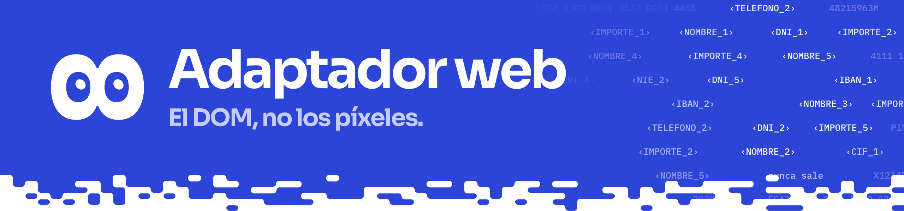

Conecta Alba Core (:5173) y el correo (:5174) con el núcleo usando Playwright. Lee el DOM y cumple `core/adapter.py`.

## Qué hay

| Archivo | Qué es |
|---|---|
| `adapter.py` | `WebAdapter`: `snapshot()`, `perform()`, `recover()`, `reset_view()`, `logged_in()`, `wait_until_logged_in()` |
| `cursor8.js` | Cursor de 8 en la ventana de Chromium (#135, #154) |
| `vista.py`, `vista8.js` | Vista de 8 (#154): espejo censurado de la pestaña para la consola |
| `tests/` | pytest: adaptador, sesión y vista de 8 |

## Uso

```bash
uv run playwright install chromium     # una vez
make web                               # las dos apps y la consola
make agent-web                         # agente en vivo sobre ellas (ANTHROPIC_API_KEY)
```

```python
from adapters.web import WebAdapter
import core

web = WebAdapter(start="inbox")
core.connect("b2b", web)
core.observe("b2b")
```

## Pruebas

```bash
uv run pytest adapters/web/tests       # arranca las apps si no están en marcha
```

`PRIV8_ALBA_URL` y `PRIV8_INBOX_URL` apuntan el adaptador y sus tests a otra copia de las apps, para probar sin tocar una demo en marcha:

```bash
(cd apps/erp-sim && pnpm exec vite --port 5190 --strictPort) & (cd apps/inbox-sim && pnpm exec vite --port 5191 --strictPort) &
PRIV8_ALBA_URL=http://127.0.0.1:5190 PRIV8_INBOX_URL=http://127.0.0.1:5191 uv run pytest adapters/web/tests
```

<details>
<summary><b>Detalles</b></summary>

- **Snapshot.** Devuelve la pantalla con valores reales (`docs/contracts/snapshot.schema.json`). Solo entran los elementos marcados con `data-p8`; el selector es `#id` o `.clase`, que es lo que casan `policies/alba-core.yaml` y `policies/inbox.yaml`.
- **Acciones.** `perform()` recibe los valores ya rehidratados y ejecuta `tap`, `type`, `key`, `scroll`, `back`, `send`, `open_app` (`alba-core` o `inbox`, una pestaña cada una) y `call`. La llamada queda de momento en `web.calls`; la real es #23.
- **Pantallas conocidas (#148).** `back` nunca sale de la app: si iría a otro origen o a una página sin `data-p8` o sin política, lleva al inicio (`/bandeja`, `/facturas/alta`). `open_app` funciona desde cualquier página. El núcleo usa `recover()` cuando `observe` no encuentra política, y el bucle llama a `reset_view()` antes de cada encargo de la consola, sin cerrar la sesión de Alba Core. Ninguno de los dos es una herramienta del modelo. Con `known=` (lo pasa `mount_web`) el adaptador pregunta a las políticas del núcleo si una pantalla sale.
- **Cursor de 8 (#135, #154).** Con ventana, antes de cada `tap`, `send`, `type` o `call` 8 se desliza hasta el elemento, deja una onda al pulsar y teclea el principio del texto; `fill()` pone después el valor entero. Es el 8 cobalto con un borde fino blanco y sus ojos, animado con el motor de `apps/console/src/eight/engine.js`. Pone la cara de lo que hace según los eventos del núcleo (`on_core_event`): curiosidad ante una pantalla nueva, leer, pensar mientras espera al modelo, hablar al escribir, sorpresa cuando el correo pide cambiar la cuenta, enfado en un bloqueo, esperar en lo retenido, duda si algo falla, apartar mientras la persona escribe un secreto, listo y alegría al terminar. A su lado va el bocadillo de 8 de la web (Companion de `apps/landing`), tecleado, con lo que hace y lo que razona: con valores en la ventana real, con tokens en la vista de 8. Añade unos 0,5 s por pulsación y 0,7 s por escritura. La capa vive en un shadow root con `data-p8-ignore` y `aria-hidden`, y el snapshot salta todo lo que cuelga de `data-p8-ignore`: el modelo ve lo mismo con cursor o sin él. `PRIV8_CURSOR=0` lo apaga y `PRIV8_CURSOR=1` lo enciende también sin ventana.
- **Toda la página (#154).** Además de lo marcado con `data-p8` (ids `e1`, `e2`...), el snapshot lleva cada texto visible como elemento de solo lectura (`extra: true`, ids `t1`, `t2`..., sin acciones): títulos, menús, etiquetas, botones, filas, cuerpo y el valor de un buscador. Como mucho 160, de hasta 280 caracteres, sin lo invisible ni lo que queda fuera de la ventana. Llevan `sel` (`#id` o `.clase`), así que las reglas del sitio también los alcanzan. El núcleo los clasifica después de lo marcado: la regla si la hay y, si no, el detector con la procedencia de la pantalla. Lo que repite un trozo de un elemento ámbar sale con su token, y lo que no pasa el bloqueo final sale como «nunca sale».
- **Vista de 8 (#154).** Mientras una consola mira, `vista.py` mantiene una página espejo en un Chromium aparte y sin ventana que el agente nunca navega. En cada cambio (como mucho cada 100 ms) vuelve a leer la página con el mismo recorrido que `snapshot()`, con sus propios ids (`data-p8-pv`), y el núcleo la clasifica igual que en `observe()` sin mandarla a ningún sitio (`core.preview`). `vista8.js` clona el documento y escribe cada texto como lo recibiría el modelo, en su sitio: la interfaz tal cual, los datos con su token, lo rojo «nunca sale». Lo que no entra en la observación pasa por `core.mask_text` y solo lo sensible se tapa. Antes de escribir la copia pasa el bloqueo final (`guard`); si no pasa, se intenta solo con lo que recibiría el modelo y, si tampoco, la vista no cambia. A la consola solo llega el screencast de ese espejo (`frame` con `vista: "8"`).
- **Sesión.** Con `profile=<carpeta>` el contexto es persistente; el agente usa `.priv8/chromium/` (`PRIV8_WEB_PROFILE` lo cambia, `off` lo apaga). Si el perfil está en uso, abre uno temporal. El adaptador nunca escribe la clave: `wait_until_logged_in(app)` espera a que entre la persona.
- **Hilos.** Chromium vive en un hilo propio porque Playwright síncrono no se puede usar desde varios hilos, y el núcleo llama desde el bucle del agente y desde el WebSocket de aprobaciones.

</details>
