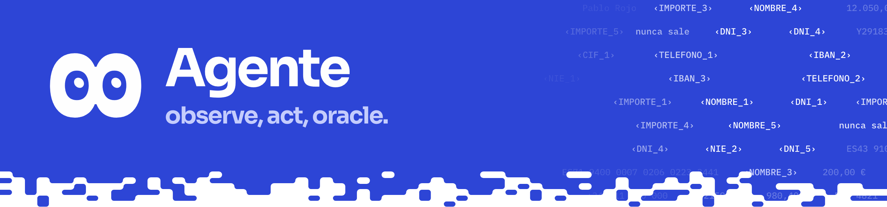

El bucle de 8 con Claude y el servidor MCP con tres herramientas: `observe`, `act` y `oracle`. Todo lo que llega al modelo ya pasó por `core/`.

## Qué hay

| Archivo | Qué es |
|---|---|
| `tools.json` | Las tres herramientas como las ve el modelo: el `*_input` de `tools.schema.json` con las referencias resueltas; las reglas condicionales van en `x-priv8-rules` y las aplica el servidor |
| `core_port.py` | Interfaz con el núcleo: `ScreenPort`, `ActPort`, `OraclePort`, `LeakCheckPort`, `AuditPort`, agrupadas en `Core` |
| `core_adapter.py` | Conecta los puertos al núcleo real (`build_real_core()`), elige núcleo con `PRIV8_CORE` (`select_core()`), monta escenas, el adaptador web (`mount_web`) o el puente Android (`mount_android`) y tokeniza la orden (`tokenize_task()`) |
| `fakes.py` | Núcleo falso en memoria con datos inventados, para los tests y `make replay-fake` |
| `server.py` | Servidor MCP (SDK oficial `mcp`): streamable HTTP en `127.0.0.1:8701/mcp` o stdio |
| `static_apps.py` | Sirve en 127.0.0.1 las builds estáticas de Alba Core, el correo y la consola para el paquete `priv8-mcp` (`--serve-apps`) |
| `asesoria.py` | Guarda de «no puedo» (#43): detecta peticiones de consejo de inversión y responde con la frase fija sin llamar al modelo |
| `agent.py` | Bucle con el SDK oficial `anthropic` (`claude-opus-5-5`, pensamiento adaptativo), límite de pasos, auditoría por paso, replay y grabación |
| `replays/` | Respuestas grabadas: `registrar_factura.json`, `b2b_web.json`, `b2c_android.json` |
| `tests/` | pytest |

## Uso

Desde la raíz del repositorio, después de `uv sync`:

```bash
make replay                  # escena B2B con respuestas grabadas sobre el núcleo real, sin clave
make replay SCENE=b2c        # escena B2C (saldo y transferencia)
make replay-fake             # «registrar factura» sobre el núcleo falso, sin clave
make agent                   # en vivo: servidor en :8701 y agente (ANTHROPIC_API_KEY)
make web                     # Alba Core :5173, correo :5174, consola :5175 (en otra terminal)
make agent-web               # en vivo sobre esas apps; encargos desde la consola
make demo-b2b                # todo el B2B de una vez
make agent-android-replay    # emulador, respuestas grabadas, sin clave (antes scripts/movil.sh)
make agent-android           # emulador en vivo; sin TASK espera tareas dictadas en el móvil
make mcp-web                 # Priv8 CUA como servidor MCP de otro host, sobre las apps web
make mcp-android             # lo mismo sobre el emulador
```

Más opciones de `agent.agent`: `--task`, `--max-steps` (20), `--session`, `--port` (8701), `--scene`, `--web`, `--android`, `--simulated-persona` / `--no-simulated-persona`, `--replay FILE`, `--record FILE`, `--server-url`, `--serve` y `--audit-out FILE`. Sale con 0 si la tarea termina.

## Pruebas

```bash
uv run pytest agent/tests
```

`tests/test_contracts.py` valida contra los esquemas de `docs/contracts/` (o de `PRIV8_CONTRACTS_DIR`); `tests/test_real_core.py` corre las dos escenas con el núcleo real y comprueba que ninguna petición a Claude lleva un valor de las escenas.

<details>
<summary><b>Detalles</b></summary>

**Garantías.**

- Solo tres herramientas: el servidor registra `tools/list` y `tools/call`; `resources/*` y `prompts/*` responden «Method not found». El agente no arranca si el servidor ofrece otra cosa.
- Cada llamada se valida contra su esquema; un error devuelve la ruta del campo, nunca el valor.
- Bloqueo final en toda respuesta de herramienta, en la entrada de `act` y en cada petición a Claude: si se escapa un patrón sensible, sale `{"denied":"fuga"}` y queda un `blocked`.
- Un dueño por evento de auditoría: el núcleo registra `observe_sent`, `act`, `held`, `approval`, `oracle` y sus `blocked`; el servidor, solo los `blocked` que el núcleo no ve; el bucle, los `task` y los `blocked` de peticiones a Claude o de asesoría. El registro completo y firmado es el del núcleo (`audit/priv8.jsonl`).
- Ejecuta, no asesora (#43): si la tarea pide elegir producto o decidir si o cuánto invertir, el modelo no la recibe; 8 dice la frase fija con `core.say` y queda `blocked` con `reason: asesoria`.

**Con las apps web (`--web`).** Chromium usa un perfil persistente (`.priv8/chromium/`); si Alba Core ya tiene la sesión abierta, 8 empieza enseguida, y si no, espera a que entre la persona. 8 nunca escribe la clave. Sin `--task`, espera el encargo de la consola (`task_request` en ws://127.0.0.1:8700/events, que llega por `core.next_task("b2b")`), lo tokeniza con `core.tokenize_text`, responde con `core.say`, espera lo retenido y vuelve a esperar. `Ctrl-C` lo para.

**En el emulador (`--android`).** El núcleo sirve el puente en `ws://127.0.0.1:8765` (`adapters/android/bridge.py`) y los eventos en :8700. El arnés, no el agente, abre Banca Alcor y espera a que la persona entre. Lo retenido va al móvil (`render_values` y `confirm_request`), 8 lo dice con la voz local y la `approval_result` vuelve por el puente. `agent/replays/b2c_android.json` suma los cuatro saldos de Alcor, Brezo y Nimbo con el oráculo (17.977,98 € con los datos de partida) y transfiere 200 € de Alcor a Nimbo; los tests usan `adapters/android/fake_phone.py`.

**Escenas y persona simulada.** `--scene b2b|b2c` monta una escena en memoria de `core/scenes.py`. Con `--simulated-persona` una persona simulada aprueba lo retenido; está activa por defecto con `--replay` y apagada en vivo. Con `--server-url` o stdio cada proceso abre su propio registro firmado: dale a cada uno su `PRIV8_AUDIT`.

**Servidor MCP para otros hosts.** Claude Code, Claude Desktop u otro agente pueden usar Priv8 CUA como su capa de *computer use* (cómo conectarlos, en el `README.md` de la raíz, «Usar Priv8 desde Claude Code»).

```bash
uv run python -m agent.server --web                       # HTTP :8701, sesión b2b
uv run python -m agent.server --android                   # HTTP :8701, sesión b2c
uv run python -m agent.server --web --transport stdio     # para un host que lo arranca él
```

- Mismos adaptadores y sesiones que el agente, y el servidor de eventos (:8700) para la consola. No se ejecuta junto a `make agent-web` ni `make agent-android`: comparten puertos. `--scene`, `--web` y `--android` son excluyentes y necesitan `PRIV8_CORE=real`.
- El montaje va en segundo plano: mientras tanto cada llamada devuelve `{"denied": "adaptador"}` con un `detail` que pide volver a observar.
- `act` devuelve lo retenido tal cual (`{"held": {"confirm": "c3"}}`) y una frase que dice dónde se aprueba (la consola o el móvil). Cada `observe` añade los ids pendientes y caduca los vencidos (`core.expire_due`).
- `instructions` de `initialize` repite las reglas del prompt de sistema de 8 (`SYSTEM` en `agent.py`).
- Con stdio, `claim_stdout()` reserva el stdout real para las tramas MCP y manda el resto a stderr.
- Paquete `priv8-mcp` (#157, mcp.priv8.es): `--serve-apps DIR` sirve las builds estáticas de Alba Core, el correo y la consola (`static_apps.py`, solo en 127.0.0.1) en los puertos que aún no responden, antes de abrir Chromium; `--open-console` abre la consola cuando Alba Core está conectado. `PRIV8_CONSOLE_URL` cambia la dirección de la consola que se da al host. El lanzador `scripts/mcp_bundle/priv8-mcp` los usa con `--web --transport stdio`.
- No cubre: lo que la persona escribe en el chat del host llega a su modelo sin tokenizar, y el registro firmado guarda las tres herramientas, no los turnos del host.

**Encargos con instrucciones fijas (#162).** «registrar factura» y cualquier petición de registrar la factura («Registra la factura de Suministros Lumen») reciben las instrucciones completas de `TASKS` en `agent.py` (`expand_task`), que no nombran a nadie: así el nombre de una empresa en la petición no acaba como un token ajeno.

**Formato de replay (`priv8-replay/1`).** Un JSON con las respuestas del modelo en orden, una por paso. El bucle las devuelve tal cual y ejecuta las herramientas de verdad, así que el resultado depende del núcleo, no del archivo.

```json
{
  "format": "priv8-replay/1",
  "model": "claude-opus-5-5",
  "task": "registrar factura",
  "responses": [
    {"stop_reason": "tool_use",
     "content": [{"type": "text", "text": "Miro la pantalla."},
                 {"type": "tool_use", "id": "toolu_r01", "name": "observe", "input": {"session": "s1"}}]},
    {"stop_reason": "end_turn",
     "content": [{"type": "text", "text": "He registrado la factura ‹FACTURA_1›."}]}
  ]
}
```

- `responses[i]` es lo que devolvería la API de Mensajes en el paso `i + 1`: `stop_reason` y `content` (`text`, `tool_use` y, si hay, `thinking`).
- Un paso sin `tool_use` termina la tarea. Los `id` de `tool_use` solo tienen que ser únicos dentro del archivo.
- Si el bucle pide más pasos de los grabados, falla con `ReplayExhausted`. `--record FILE` escribe este formato desde una ejecución en vivo. `ReplayModel` y `write_replay` están en `agent/agent.py`.

**Lo que el núcleo expone.** `core_adapter.py` espera cinco funciones de `core` que devuelven `dict` compatibles con JSON: `observe(session)` (`observation.schema.json`), `act(session, op, target=None, text=None, direction=None)` y `oracle(session, op, args)` (`tools.schema.json`), `check(payload)` con `allowed` y `findings` (el tipo de patrón, nunca el valor) y `record(event)` (`audit.schema.json`, con `seq`, `ts`, `prev`, `hash` y `sig`). `PRIV8_CORE=real|fake` elige el núcleo (por defecto `real`); si a `core` le falta alguna función, `build_real_core()` lanza `RealCoreUnavailable` con los nombres que faltan.

</details>
