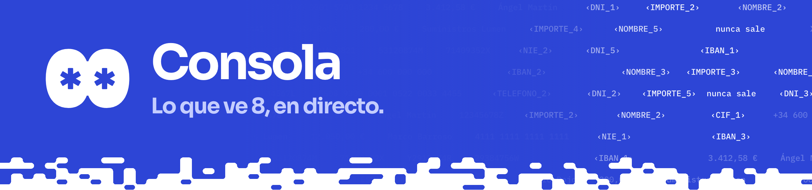

Lo que ve 8, en directo y en local: escucha `ws://127.0.0.1:8700/events`. React y Vite, con el diseño de la web y las fuentes empaquetadas, así que funciona sin red.

| Pestaña | Qué enseña |
|---|---|
| En directo | 8 animado, lo que ve 8 (la vista censurada del adaptador), su razonamiento y el chat **Pide a 8** con las confirmaciones |
| Alarmas | Posible fraude: cambio de cuenta por correo, órdenes a la IA, bloqueos |
| Pantalla | Cada elemento: lo que ves y lo que ve la IA, en ámbar o rojo |
| Registro | La actividad, la latencia por paso y **Verificar registro** |

```sh
python -m core.server        # núcleo en :8700 (desde la raíz del repo)
cd apps/console
pnpm install
pnpm dev                     # http://127.0.0.1:5175
pnpm build
for t in alertas tokens directo vivo frame; do node src/$t.test.mjs; done   # pruebas sin dependencias
```

| Sin núcleo ni IA | |
|---|---|
| `?demo` | Reproduce `public/demo.json`, la factura con la trampa del IBAN |
| `?feed=sin-protocolo` / `?feed=con-protocolo` | El mismo trámite con 6 y con 0 valores reales al modelo (`make sin-protocolo`, `make videos`) |

El mensaje `screen` lleva valores reales: abre la consola solo en la máquina del núcleo.

<details>
<summary><b>Detalles</b></summary>

La vista principal son dos cosas: 8 en directo y el chat. Lo demás va en pestañas de la barra cobalto (**En directo**, **Alarmas**, **Pantalla**, **Registro**), con insignias para lo que espera: confirmaciones pendientes, alarmas sin revisar y bloqueos. La pestaña va en la URL (`#alarmas`, `#pantalla`, `#registro`).

- **En directo**: banda cobalto con 8 animado (`src/eight/`, copia del motor de la web) y, en una línea, lo que hace ahora (`src/directo.js`), con el paso y el tiempo del encargo. Debajo, la pantalla; a la derecha, el razonamiento y el chat, cada uno con su desplazamiento:
  - **Lo que ve 8** (`src/Vista8.jsx`, lógica en `src/frame.js`, #147, #154): solo lo que ve 8, tan grande como cabe. En web es la *vista de 8* que manda el adaptador (mensaje `frame` con `vista: "8"`): una página espejo con la pestaña de 8 censurada en el DOM antes de pintarse, con los tokens, «nunca sale», los marcadores de lo que el modelo no recibió, el cursor de 8 y su bocadillo ya dentro. La consola la pinta tal cual, sin tapar nada encima, así que nada se desalinea al moverse la página. En Android vuelve a pintar la pantalla con lo que vio el modelo de cada elemento en su sitio; la captura real del móvil no se enseña. **Pantalla completa** abre `?vista=8`: la misma vista de borde a borde, con una cabecera mínima de 8. La consola pide los fotogramas conectando con `?frames=1`; el núcleo solo los genera mientras alguna consola mira, nunca los registra y descarta los que no le da tiempo a enviar.
  - **La pantalla de 8 en esquema** (`src/Vivo.jsx`, lógica en `src/vivo.js`), cuando no llegan fotogramas (`?demo`, `?feed=`, sin núcleo): la última pantalla que ha leído 8, dibujada como una ventana (Alba Core, Correo) o como un móvil si viene de Android (Banca Alcor, Brezo Banco, Nimbo Bróker). El cursor de 8 (sus ojos en una píldora cobalto) se desliza hasta el elemento de cada acción: al pulsar deja una onda, al escribir las letras aparecen en el campo, al cambiar de pantalla la ventana pasa, un bloqueo pone el elemento en rojo con el motivo y una acción retenida late en ámbar con «Esperando tu confirmación». El oráculo señala el dato que compara.
  - **Razonamiento y acciones** (panel lateral): cada paso, en orden y con el tiempo desde el inicio del encargo (observa, pulsa, escribe, pregunta al oráculo, bloqueado, espera, aprobado) y «pensando» mientras espera al modelo. Lo que razona 8 se pinta con su markdown (negrita y listas, `src/md.js`); la respuesta final solo va entera en el chat. Solo tokens. Sigue el final salvo que subas.
  - Los mensajes se reproducen con su ritmo (el cursor llega, pulsa, teclea); si llegan muchos de golpe, se acelera para no quedarse atrás.
- **Pide a 8**: chat para pedir encargos (`task_request` con la sesión de la última pantalla, por defecto `b2b`; el texto no se registra), con sugerencias para la demo B2B. Las frases de 8 (`voice`) se ven con los valores reales en local; las confirmaciones aparecen dentro del chat con la frase, el origen de cada dato, la cuenta atrás y Aprobar/Rechazar (`approval_result`, `via: pantalla`, `by: persona`). En `?demo` y `?feed=` el campo está desactivado.
- **Alarmas** de posible fraude (cambio de cuenta por correo, órdenes a la IA, bloqueos del núcleo), con Marcar como revisada.
- **Pantalla**: cada elemento en una fila con lo que ves y lo que ve la IA. En lo que ves se marca en ámbar el trozo exacto que se ha cambiado por un token; la fila tiene fondo ámbar suave si está tokenizada y rojo suave si nunca sale o va en claro.
- **Registro**: la actividad en orden inverso, filtrable por bloqueos y confirmaciones, la latencia media por paso (`ms.core`, `ms.adapter`, `ms.model`) y **Verificar registro**, que llama a `GET http://127.0.0.1:8700/verify` (cadena de hashes y firma del registro de auditoría) y devuelve `{ok, lines, error}`.

Se reconecta sola si el núcleo se cae. La vista En directo cabe en la ventana (probada a 1280x800, 1440x900, 1512x982 y 1920x1080): la página no se desplaza, solo el razonamiento y el chat.

**Otro núcleo sin tocar la demo:** `PRIV8_EVENTS_PORT=8790 PRIV8_EVENTS_ORIGINS=http://127.0.0.1:5199` en el núcleo y `?ws=ws://127.0.0.1:8790/events` en la consola (solo se aceptan 127.0.0.1 y localhost).

**Demo sin núcleo ni IA:** abre `http://127.0.0.1:5175/?demo`. Reproduce `public/demo.json`, los mensajes reales del núcleo en el flujo de la factura con la trampa del IBAN (datos ficticios del seed), capturados sin llamar a la API.

El mensaje `screen` lleva valores reales: la consola solo debe abrirse en la máquina del núcleo.

**El mismo trámite con y sin protocolo (#45):** `make sin-protocolo` ejecuta la escena B2B de `metrics/b2b.py` (núcleo real, respuestas grabadas, sin API) y escribe dos feeds en `public/`:

- `?feed=sin-protocolo`: banda noche «Sin protocolo: el modelo recibe los datos reales». En la pantalla de 8, lo que recibe el modelo lleva los valores del seed marcados en rojo y la cuenta de valores reales enviados al modelo (acaba en la misma cifra que `make metrics`: 6). No hay oráculo, bloqueos ni confirmaciones.
- `?feed=con-protocolo`: la misma ejecución con Priv8 CUA (tokens, alarmas, dos bloqueos y tres confirmaciones), con 0 valores reales al modelo.

**Una sesión real grabada (#170):** `?feed=sesion-b2b` reproduce una sesión real del agente en directo, para la web de la demo, que no tiene agente, núcleo ni API. `make grabar-sesion` (`scripts/grabar_sesion.py`) la graba una vez: arranca Alba Core y el correo en puertos libres (5193 y 5194) y el agente real (`--web`, Chromium con ventana, el `.env`, eventos en :8792), pide en el chat «Registra la factura de Suministros Lumen», aprueba la confirmación a los pocos segundos y después pide «Contesta al proveedor que la factura está registrada». Nunca toca 5173-5175, 8700, 5301 ni 5303. Guarda en `public/sesion-b2b.json` cada mensaje que recibe la consola con su segundo, y en `public/sesion-b2b/` los JPEG de la vista de 8 y de la ventana real de Chromium (con los datos ficticios del seed, el cursor de 8 y sus bocadillos), en pares, sin repetidos y a 5 por segundo como mucho (ver «Pares de fotogramas»). Como el modelo no siempre sigue el flujo ensayado, repite el intento (hasta 6) si algún encargo no pide confirmación, el oráculo no cuadra o 8 dice que no lo ha hecho. Al final comprueba que ningún valor del `.env` ha entrado en la grabación.

En la reproducción (`src/reproductor.js`) todo va como en directo: las pantallas, el razonamiento, el chat (los encargos de la persona, las frases de 8 y la confirmación, que pasa a «Aprobada» cuando llega la aprobación grabada) y las pestañas. Abajo, reproducir y pausar, reiniciar, velocidad 1x o 2x y el tiempo. Arranca sola y el campo del chat está desactivado.

**Lo que ves tú y lo que ve el modelo (#170):** en web, el adaptador manda también la pestaña real que maneja 8, en el mismo mensaje que la vista de 8 (`frame` con `vista: "8"`, `par` y `real`, solo por el canal local). La consola enseña las dos a la vez, en En directo y arriba de la pestaña Pantalla: **Lo que ves tú** (la ventana real, con los valores) y **Lo que ve el modelo** (la vista de 8). Lado a lado si hay sitio a lo ancho, una encima de otra en pantallas estrechas (`DosPantallas` en `src/Vista8.jsx`). En Android y en los feeds sin pantalla real sigue solo lo que ve 8.

**Pares de fotogramas (#187):** en cada momento las dos pantallas enseñan lo mismo (pantalla, desplazamiento, cursor y cara de 8, bocadillo, paso); lo único distinto son los valores reales cambiados por tokens. El adaptador las captura juntas (`adapters/web/README.md`) y la consola las pinta juntas: `DosPantallas` decodifica las dos imágenes del par y solo entonces cambia las dos a la vez; mientras llega el siguiente par, siguen las dos del anterior. Una pestaña real suelta, sin su vista de 8, no se pinta. En las grabaciones (`priv8-sesion/1`) van en una sola lista:

```
pares: [{at, par, real: {src, w, h, app, par} | null, ocho: {src, w, h, app, screen, fresh, paused, par}}]
```

Los fotogramas ya no van en `eventos`, y `real` solo lleva las capturas sueltas de Android (sin vista de 8: lo que ve el modelo se dibuja con los mensajes `screen`). Los grabadores comprueban antes de escribir que cada par es del mismo paso (`pares_incoherentes` en `scripts/casos_comun.py`) y `make test` lo comprueba en cada `public/sesion-*.json` (`src/sesiones.test.mjs`, `scripts/tests/test_pares.py`). Las grabaciones anteriores, con las dos listas sueltas, se emparejan al cargarlas (`migrar` en `src/reproductor.js`): cada fotograma real con el de la vista de 8 más cercano en el tiempo, sin volver atrás (`dt` en cada par, `migrado: true`). `scripts/migrar_pares.py` hace lo mismo en el JSON; así está ya `sesion-b2b.json` y sus recortes. En una migrada el cursor y el bocadillo de cada lado se animaban por separado, así que puede haber diferencias de unas décimas; una grabación nueva (`make grabar-casos`) sale en pares exactos.

`make videos` (o `make video-sin-protocolo` y `make video-con-protocolo`) graba los dos con Playwright a 1440×900 en `docs/entregables/video/` (`.webm` y, con ffmpeg, `.mp4`). `scripts/grabar_consola.py --frames DIR` guarda además capturas para revisar la grabación.

</details>
