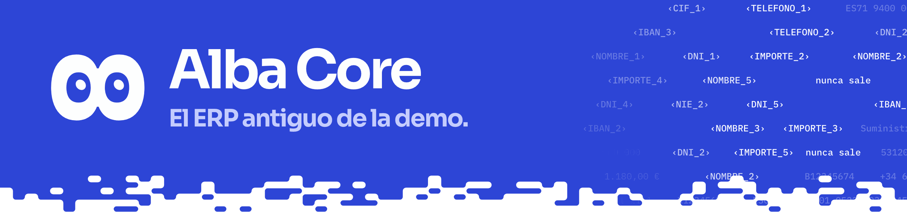

Un ERP de escritorio antiguo, sin API, servido en el navegador: la pantalla del B2B. 8 lo usa solo a través de `adapters/web/`, con `data/seed.json`.

## Qué hay

| Archivo | Qué es |
|---|---|
| `src/App.jsx` | Pantallas y rutas del ERP |
| `src/sesion.js` | Sesión ya abierta de la demo (#137) |
| `src/alba.css` | Aspecto del ERP |
| `src/sesion.test.mjs` | Prueba de la sesión |

| Ruta | Pantalla | Política |
|---|---|---|
| `/login` | Identificación | `login` |
| `/facturas/alta` | Alta de factura del pedido recibido (Suministros Lumen, PED-2026-3318) | `factura.alta` |
| `/proveedores/7` | Ficha del proveedor con el IBAN maestro y el teléfono | `proveedor.ficha` |
| `/proveedores`, `/facturas` | Listados | - |
| `/reset` | Borra la sesión y las facturas registradas (con la sesión de la demo, vuelve a abrirla) | - |

## Uso

```bash
cd apps/erp-sim
pnpm install
pnpm dev          # http://127.0.0.1:5173
```

`make web` lo arranca junto con la bandeja y la consola. Usuario de la demo: `admin.alba` / `Alba-2026!`. La clave es roja: la escribe la persona, nunca el agente.

## Pruebas

```bash
node apps/erp-sim/src/sesion.test.mjs
```

Desde la raíz (también entra en `make test`). El comportamiento con el agente lo prueban `adapters/web/tests`.

<details>
<summary><b>Detalles</b></summary>

- **Sesión ya abierta (#137).** Con `VITE_ALBA_SESION=admin.alba pnpm dev` (lo hace `make demo-b2b`) Alba Core abre con esa sesión, como el ordenador de una empresa. Solo en desarrollo; una build la lleva únicamente con `VITE_ALBA_SESION_BUILD=1` (lo hace `scripts/build_mcp_bundle.sh` para el paquete `priv8-mcp`). Si la persona pulsa «Cerrar sesión», queda cerrada hasta que vuelve a entrar con su clave.
- **Contrato con el adaptador web.** Solo entra en el snapshot lo que lleva `data-p8="<role>"` (roles de `docs/contracts/common.schema.json`). El selector es `#id`, que es lo que casan `policies/alba-core.yaml` y la escena `b2b` de `core/scenes.py`. `data-p8-label` da la etiqueta; `data-p8-actions` sustituye a las acciones por defecto del rol (`""` sin acciones, `call` en el teléfono de la ficha).
- Las facturas registradas se guardan en `localStorage`.

</details>
