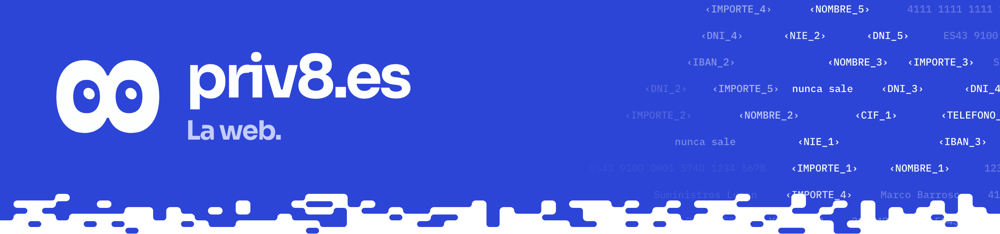

La web pública, [priv8.es](https://priv8.es): Vite y React, con 8 en vivo y el campo de datos. Su estilo es el de todos los gráficos de este repositorio.

## Qué hay

| Ruta | Qué es |
|---|---|
| `index.html`, `src/main.jsx`, `src/App.jsx` | Página principal: portada y secciones |
| `src/Story.jsx`, `src/Sections.jsx`, `src/More.jsx`, `src/Products.jsx`, `src/Demos.jsx` | Secciones: qué ve el modelo, por qué ahora, productos, arquitectura, garantías, desarrolladores, comparativa, cumplimiento |
| `src/eight/` | 8 animado (`Eight.jsx` y el motor `engine.js`) |
| `src/Companion.jsx`, `src/companion.js` | El 8 que acompaña por la página y cambia de cara según la sección |
| `src/Nav.jsx`, `src/Field.jsx`, `src/texture.js`, `src/useTheme.js` | Navegación, fondo de datos y tema claro u oscuro |
| `src/team.js`, `src/logos.js` | Equipo y logos de los proveedores de modelos |
| `404.html`, `src/notfound.jsx` | Página de error |
| `public/` | Favicon, icono para iOS y logos claro y oscuro |
| `vite.config.js` | Dos entradas (`index.html`, `404.html`); `base` sale de `BASE_PATH` o queda relativa |

## Uso

```bash
cd apps/landing
pnpm install && pnpm dev      # http://localhost:5180
pnpm build                    # dist/
pnpm preview                  # sirve dist/ en :5180
```

En local la build usa rutas relativas, así que `dist/` se abre tal cual, también desde el ZIP.

## Pruebas

No tiene pruebas propias: `pnpm build` debe terminar sin errores.

<details>
<summary><b>Detalles</b></summary>

- **Despliegue.** `.github/workflows/landing-pages.yml` la publica en GitHub Pages al subir a `main` cambios de `apps/landing/` o del propio flujo, o a mano desde la pestaña Actions. Instala con `pnpm install --frozen-lockfile`, construye con `BASE_PATH` (la raíz con el dominio propio, `/<repositorio>/` sin él) y sube `apps/landing/dist`.
- Requisito una vez en el repositorio: Settings → Pages → Source: «GitHub Actions».

</details>
