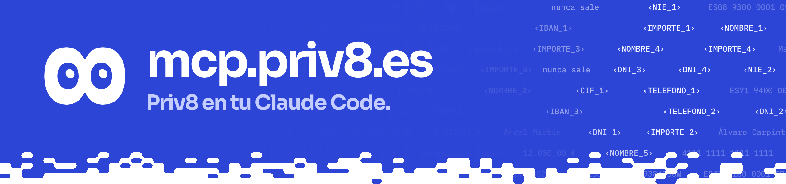

[mcp.priv8.es](https://mcp.priv8.es): cómo usar Priv8 con tu asistente (Claude Code, Codex, Gemini CLI, Grok CLI, Cursor, opencode o cualquier otro que hable MCP) y el instalador de una línea del paquete `priv8-mcp` (#157, #195). Sitio estático con Vite y React.

## Qué hay

| Archivo | Qué es |
|---|---|
| `src/App.jsx` | La página: qué hace Priv8, el instalador y los pasos |
| `src/Asistentes.jsx`, `src/ia/` | Los seis asistentes con su icono y el reloj compartido del rotador (copia de `apps/landing`). Iconos: Simple Icons (CC0) y LobeHub Icons (MIT) para Grok |
| `src/conectar.jsx` | Cómo conectar Priv8 en cada asistente, con el enlace a su documentación |
| `src/Field.jsx`, `src/texture.js` | Fondo animado |
| `src/eight/` | 8 con el motor de los ojos de la web |
| `src/team.js` | Equipo |
| `vite.config.js` | Configuración de Vite |

## Uso

```bash
cd apps/mcp-site
pnpm install
pnpm dev                       # http://127.0.0.1:5301
make mcp-site                  # desde la raíz: el paquete y el sitio en apps/mcp-site/dist/
```

`make mcp-site` ejecuta `scripts/build_mcp_site.sh`, que deja en `dist/` el sitio, `instalar.sh`, `priv8-mcp.tar.gz`, su `.sha256` y las cabeceras `_headers` de Cloudflare Pages. No despliega nada: los pasos están en [`docs/despliegue-subdominios.md`](../../docs/despliegue-subdominios.md).

## Pruebas

No tiene tests propios: `pnpm build` debe terminar sin errores. El instalador y el lanzador del paquete están en `scripts/mcp_bundle/` (ver su README).
